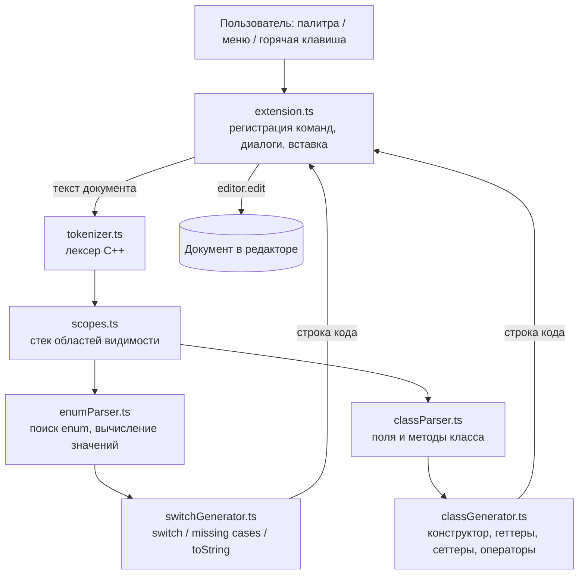
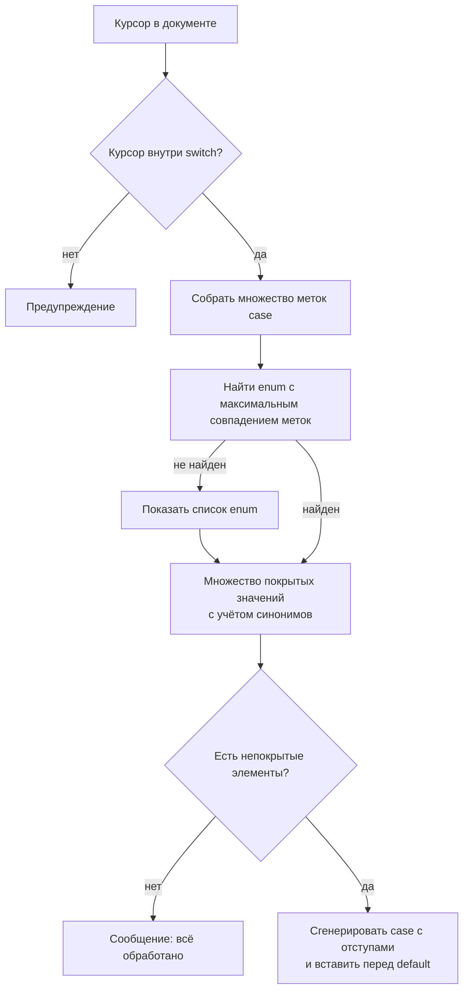

# CppForge — документация проекта

## 1. Техническое задание

1. Плагин для Visual Studio Code, работающий с файлами C++ (`.cpp`, `.h`, `.hpp`).
2. Команда генерации `switch` по выбранному перечислению:
   - перечисление определяется по слову под курсором, иначе выбирается из списка;
   - поиск перечислений в текущем файле и в заголовочных файлах рабочей области;
   - поддержка `enum` и `enum class`, вложенных в `namespace`/классы (полные имена);
   - элементы-синонимы (с одинаковым значением) не порождают повторяющихся `case`.
3. Команда дополнения существующего `switch` недостающими `case`:
   - перечисление определяется автоматически по уже написанным меткам;
   - новые ветки вставляются перед `default` с сохранением отступов;
   - если все элементы обработаны — выводится сообщение, код не меняется.
4. Команда генерации `toString()` для перечисления.
5. Команда генерации членов класса по его полям (выбор нескольких пунктов):
   конструктор, геттеры, сеттеры, `operator==`/`!=`, `operator<<`.
   - уже существующие методы не дублируются;
   - для `const`-полей, ссылок и массивов сеттеры не создаются;
   - результат должен компилироваться (`g++ -std=c++17 -Wall`).
6. Доступ к командам: палитра команд, контекстное меню, горячие клавиши.
7. Настройки: наличие `default`, стиль геттеров, поиск в заголовках.
8. Логика анализа и генерации не зависит от API VS Code и покрыта модульными тестами.

## 2. Как VS Code подключает расширения

VS Code построен на Electron. Сам редактор работает в процессе отрисовки, а все
расширения выполняются в отдельном процессе **Extension Host** (Node.js). Благодаря
этому медленное или упавшее расширение не «вешает» интерфейс. Расширение общается с
редактором только через объект `vscode` (Extension API), вызовы передаются по RPC.

Расширение — это npm-пакет, у которого в `package.json` есть:

- `engines.vscode` — минимальная версия редактора;
- `main` — JS-файл с функциями `activate()` и `deactivate()`;
- `contributes` — **декларативное** описание того, что расширение добавляет в
  интерфейс: команды, пункты меню, горячие клавиши, настройки. VS Code читает этот
  раздел без запуска кода расширения и сразу показывает команды в палитре;
- `activationEvents` — когда загружать код. Начиная с VS Code 1.74 события для
  команд из `contributes.commands` формируются автоматически: расширение загружается
  при первом вызове любой из его команд (ленивая активация).

Жизненный цикл: пользователь вызывает команду → Extension Host загружает
`out/extension.js` и вызывает `activate(context)` → там через
`vscode.commands.registerTextEditorCommand` связываются идентификаторы команд с
обработчиками → обработчик получает активный редактор, читает текст документа и
применяет изменения через `editor.edit(...)` (одна правка = один шаг Undo).

## 3. Архитектура плагина



Слои:

| Слой | Файлы | Зависит от VS Code |
|---|---|---|
| Интеграция с IDE | `src/extension.ts` | да |
| Анализ кода | `src/parser/*.ts` | нет |
| Генерация кода | `src/generators/*.ts` | нет |
| Тесты | `src/test/*.ts` | нет |

### 3.1. Лексер (`tokenizer.ts`)

Однопроходный автомат по символам. Выдаёт массив `Token {kind, value, offset, end}`.
Пропускает комментарии и строки препроцессора, поэтому `// enum Fake {}` в
комментарии не будет принят за перечисление. Смещения нужны, чтобы потом точно
вставить код в документ.

### 3.2. Области видимости (`scopes.ts`)

Проход по токенам со **стеком** открытых `{`. Для каждой скобки по предшествующим
токенам определяется, что она открывает: `namespace`, `class`, `struct`, `enum`
или обычный блок. Из этого строятся полные имена (`game::Unit::State`) и находится
класс, в котором стоит курсор.

### 3.3. Разбор перечислений (`enumParser.ts`)

Тело `enum` делится на элементы по запятым верхнего уровня. Значения вычисляются
**рекурсивным спуском** по приоритетам операций (`|` → `&` → `<< >>` → `+ -` →
`* / %` → унарные → литералы/имена/скобки). Используемые структуры данных:

- `Map<string, number>` «имя → значение» — для ссылок вида `B = A + 1`;
- `Map<number, string>` «значение → первый элемент» — для поиска синонимов;
- `Map<string, EnumInfo[]>` — индекс перечислений по короткому и полному имени.

### 3.4. Генерация switch (`switchGenerator.ts`)

- `generateSwitch` — проходит по уникальным элементам, синонимы пишет в комментарий.
- `findSwitchAt` — находит самый внутренний `switch` вокруг курсора, собирает
  `Set<string>` существующих меток (метки вложенных `switch` не учитываются),
  определяет место вставки (перед `default:` или `}`) и отступы.
- `matchEnumForSwitch` — выбирает перечисление, элементы которого покрывают
  больше всего меток.
- `generateMissingCases` — строит `Set<number>` уже покрытых значений и
  генерирует ветки только для непокрытых элементов.

### 3.5. Разбор класса (`classParser.ts`)

Тело класса читается как последовательность объявлений, разделённых `;`; тела
методов и вложенных типов `{...}` пропускаются целиком. Отслеживаются
модификаторы доступа. Объявление с `(` на верхнем уровне (вне `<...>`) — метод
(его имя запоминается в `Set` существующих методов), иначе — поля.

### 3.6. Генерация членов класса (`classGenerator.ts`)

- `Set` «дешёвых» типов определяет передачу по значению или по `const&`;
- `Map` «шаблон STL → стратегия вывода» определяет, как поле попадёт в `operator<<`
  (напрямую / через `.size()` / пропуск);
- имена геттеров/сеттеров строятся из имени поля без `m_`, `_`, суффикса `_`.

## 4. Алгоритм команды «Дополнить switch»



## 5. Структура репозитория

```
cppforge/
├── package.json          манифест расширения (команды, меню, клавиши, настройки)
├── tsconfig.json
├── typedoc.json          настройки генератора документации
├── src/
│   ├── extension.ts      точка входа, команды
│   ├── parser/
│   │   ├── tokenizer.ts
│   │   ├── scopes.ts
│   │   ├── enumParser.ts
│   │   └── classParser.ts
│   ├── generators/
│   │   ├── switchGenerator.ts
│   │   └── classGenerator.ts
│   └── test/parser.test.ts
├── examples/             файлы для демонстрации
├── docs/api/             HTML-документация (TypeDoc)
├── README.md
└── DOCS.md
```

## 6. Ограничения

- Анализатор упрощённый и не раскрывает макросы: перечисление, объявленное через
  `#define`, найдено не будет.
- Значение элемента, заданное через `constexpr`-переменную или `sizeof`, не
  вычисляется; такой элемент всё равно получает `case`, но синонимы для него не ищутся.
- Шаблонные классы поддерживаются для полей, но в `operator==` параметр
  записывается без шаблонных аргументов (что корректно внутри шаблона класса).
